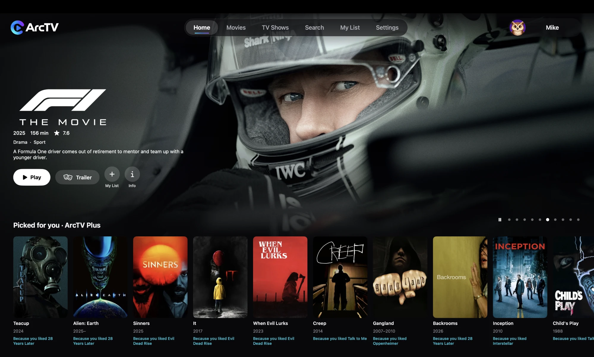

<h1 align="center">Arc TV for Mac</h1>

<p align="center"><b>Your streaming, your way, on your Mac.</b><br>
A native, Netflix-style streaming app for Stremio-protocol addons, built with Swift and SwiftUI.</p>

<p align="center">
  <a href="https://github.com/MikeC444/ArcTV-Mac/releases/latest"><b>Download for Mac</b></a> ·
  <a href="#-installing">Install it</a> ·
  <a href="https://arctv.org">arctv.org</a>
</p>

<p align="center">
  
</p>

Arc TV is a modern media center for your Mac. Content comes from **Stremio addons** rather than a fixed catalog, so you choose the addons you want, the same way Stremio itself works. Arc TV ships with no content of its own.

It is a native Mac app (not a web page in a window) for **Apple Silicon Macs on macOS 14 or later**, and it uses the same account as the [Fire TV, Firestick and Android TV app](https://github.com/MikeC444/ArcTV-AndroidTV), the [phone app](https://github.com/MikeC444/ArcTV-MobileAPK) and the [web app](https://web.arctv.org), so your list and addons are already there when you sign in.

## ✨ Features

- **Addon-powered**: discover movies and series from whichever Stremio-protocol addons you install, and add, switch off or remove them from the app
- **Sync everywhere**: your My List, Continue Watching, settings and addons follow you between your Mac, your TV, your phone and the web
- **A player that plays more**: the built-in player plays 4K, HEVC, HDR and Dolby Vision files that the Mac's own player can't, with audio, subtitle and speed menus, a full-screen button, next episode and autoplay, and it remembers your volume and speed
- **Torrents inside the app**: torrent sources play right inside Arc TV, with settings for the buffer size and how much disk space a torrent may use
- **Made for the Mac**: right-click any poster for a quick menu (Play, My List, Watched, Like and Not for me), search suggestions you can move through with the arrow keys, and a top bar that slides away as you scroll
- **Easy sign-in**: sign in with your email and password, or scan a QR code with your phone. Your sign-in is kept in a private file, so Arc TV never asks for your Mac password
- **Browse your way**: Home, Movies, TV Shows, Search and My List, with a title page showing the logo, trailer, rating, cast and more like it, and a source list with quality filters and sorting
- **Picked for you**: a Home row chosen from the movies and shows you like, finish and save, with the reason under each poster
- **Stays up to date**: Arc TV tells you when a new version is out and what changed, and you can check in Settings
- **ArcTV Plus** (optional; the app stays free): up to 5 profiles with kids profiles and PIN locks, Picked for you, Smart source picking, your watch stats, and a **Download** button that saves movies and episodes to your Mac

## 📱📺 Arc TV everywhere

Same account, same list, same addons on every device:

| | |
|---|---|
| 💻 **Mac** | this repository |
| 📺 **Fire TV / Firestick / Android TV / Google TV** | [ArcTV-AndroidTV](https://github.com/MikeC444/ArcTV-AndroidTV), also home of the account backend (`server/`) |
| 📱 **Android phones and tablets** | [ArcTV-MobileAPK](https://github.com/MikeC444/ArcTV-MobileAPK) |
| 🌐 **Web** | [web.arctv.org](https://web.arctv.org) ([ArcTV-Web](https://github.com/MikeC444/ArcTV-Web)) |

## 💻 Installing

1. Download **`ArcTV-0.1.0.dmg`** (or the newest `ArcTV-<version>.dmg`) from [the latest release](https://github.com/MikeC444/ArcTV-Mac/releases/latest), open it and drag Arc TV into Applications.
2. The app is **not signed with an Apple Developer ID and not notarized**, so macOS warns the first time you open it:
   - **macOS 14:** right-click Arc TV, choose **Open**, then **Open** again.
   - **macOS 15 and later:** try to open it once, then go to **System Settings > Privacy & Security**, scroll down and click **Open Anyway**.
   - Or, in Terminal: `xattr -d com.apple.quarantine /Applications/ArcTV.app`

(The exact wording differs between macOS versions.) The app does carry a free ad-hoc signature, which Apple Silicon Macs need to run it at all.

3. Open **Arc TV**, sign in with your Arc TV email and password (or create an account), and add an addon if you don't have one yet.

## ❓ Questions

**Where do the movies and shows come from?** From the Stremio addons you add. Arc TV only plays what an addon provides and does not host or supply any content.

**Is it free?** Yes. Browsing, playing, My List, Continue Watching and addons are free. ArcTV Plus adds extras on top.

**Is Arc TV affiliated with Stremio?** No. Arc TV is an independent app that supports the Stremio addon format, so addons made for Stremio work in it. It is not affiliated with or endorsed by Stremio.

**Does it run on an Intel Mac?** Not for now. It needs Apple Silicon (M1 or newer) and macOS 14 or later.

**Why the warning when I open it?** The app isn't notarized by Apple yet, so macOS asks you to confirm once. The steps above show how.

## 🛠️ For developers

The app is Swift and SwiftUI, built as a Swift package and talking to the same account backend and Stremio-protocol addons as the other Arc TV apps (the backend lives in the Fire TV repository's `server/`).

### Building

Needs an Apple Silicon Mac on macOS 14+ with Xcode's command line tools (Swift 5.9+) and `brew install libtorrent-rasterbar` (the torrent engine).

```
swift test                              # the tests (ArcTVCore: addon protocol, account API, Home rows)
swift run ArcTV                         # run it from the command line
scripts/package-app.sh 0.1.0            # build/ArcTV.app and build/ArcTV-0.1.0.dmg
```

The backend address is baked in from the `API_BASE_URL` environment variable when packaging (the release workflow reads it from a repository
secret of the same name). It can also be typed on the sign-in screen, so a build without it still works.

### Layout

- `Sources/ArcTVCore`: everything that isn't on screen, so it can be tested on its own.
- `Sources/ArcTV`: the SwiftUI app.
- `Tests/ArcTVCoreTests`: unit tests.
- `.github/workflows/build.yml`: builds and tests every push and keeps an unsigned DMG as a build artifact.
- `.github/workflows/release.yml`: on a version tag or a manual run, builds the DMG and publishes a GitHub Release with the patch notes.

### Releasing

Add each user-visible change as a bullet under `## Unreleased` in `RELEASE_NOTES.md`, then run the **Build and publish release DMG** workflow with
a version (for example `0.1.0`). The notes under Unreleased become the release's notes and are filed under the version afterwards.
